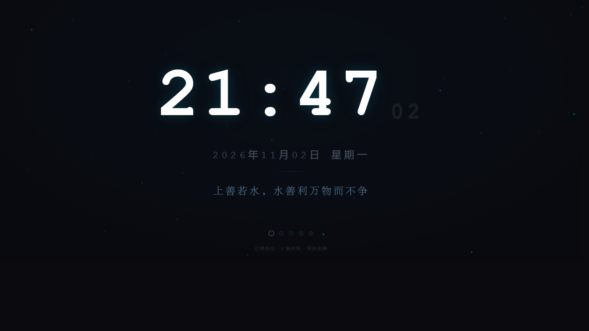
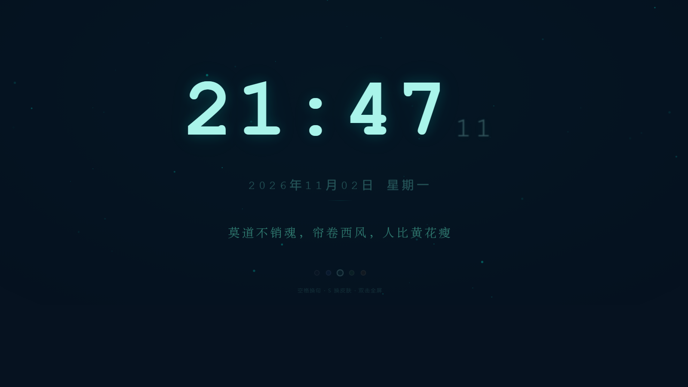
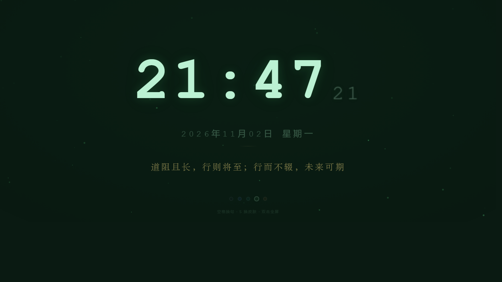

<div align="center">

# 诗钟 · Shizhong

**一座会念诗的钟。**

打开就满屏的大字北京时间，配一句值得反复读的话。
零依赖、零联网、单文件。5 套深色皮肤，呼吸的粒子，每 8 秒换一句。

[](LICENSE)
[](#)
[](#)
[](#)



</div>

---

## 为什么叫「诗钟」

诗钟是清代福州文人的一种限时作诗游戏，如今是福建省非物质文化遗产。

桌上立一只铜鹤，鹤嘴衔枝，红线一端系在香炉里的檀香上，另一端坠一枚铜钱，下面承一面铜盘。出题、焚香、落笔——香烧到线断，铜钱落进铜盘，「叮」的一声如钟鸣，即告交卷。**香尽钟鸣，诗成于此**，名字就是这么来的。

这个程序借了它的规矩：一座钟，一句诗，八秒一换。香换成了秒针，其余没变。

> 只是借名。「诗钟」是通用名称，本项目与相关非遗保护单位、诗社团体无关。

## 简介

一个用来摆在桌面、平板或者旧显示器上的全屏时钟。没有账号、没有后端、不申请任何权限，双击 `index.html` 就能用。

时间按 UTC+8 独立计算，**不受系统时区影响**——你在哪个时区打开，显示的都是北京时间。标语库收录 232 条，其中 202 条是古典诗文，随机洗牌后交叉轮播，不会连着几条都是同一类。

界面刻意做得很安静：没有边框、没有按钮、没有秒针的跳动声。所有动画都用了长缓动，秒数变化是一次轻柔的上浮而非闪烁。

## 特性

- **单文件** —— 一个 `index.html` 装下全部 HTML、CSS、JavaScript，无外部字体、无 CDN、无追踪
- **离线可用** —— 断网、飞行模式、内网环境都能正常运行
- **时区无关** —— 内部按 UTC+8 换算，不依赖系统时区设置
- **232 条标语** —— 202 条古诗词与文言名句、30 条现代短句，Fisher-Yates 洗牌后全类别交叉轮播
- **5 套皮肤** —— 午夜经典、藏青·星河、藏青·极光、墨绿·森林、墨绿·暗夜
- **粒子与光晕** —— Canvas 绘制的呼吸浮游粒子，颜色随皮肤联动；鼠标位置有缓动跟随的柔光
- **双端交互** —— 桌面用键盘和鼠标，平板用触屏手势，同一份文件
- **适配 iPad** —— 动态视口高度、安全区留白、屏幕常亮、可添加到主屏幕后全屏运行

## 预览

| 午夜经典 | 藏青·极光 | 墨绿·森林 |
| :---: | :---: | :---: |
|  |  |  |

## 快速开始

### 方式一：直接打开

下载 `index.html`，双击。浏览器会以本地文件方式打开，完全离线运行。

### 方式二：GitHub Pages（推荐）

1. 把本仓库推到 GitHub
2. 进入仓库 → **Settings** → 左侧 **Pages**
3. **Source** 选 `Deploy from a branch`，**Branch** 选 `main`、目录选 `/ (root)`，点 **Save**
4. 等一两分钟，访问 `https://<你的用户名>.github.io/<仓库名>/`

`.nojekyll` 已经放好了，GitHub Pages 会跳过 Jekyll 处理，直接按静态文件发布。

> 想要真正的全屏、没有地址栏？在 iPad 或手机的 Safari 里打开上面的网址，点分享按钮 → **添加到主屏幕**，之后从桌面图标启动即可。

### 方式三：局域网

```bash
# 在项目目录下起一个静态服务器
python -m http.server 8000
```

然后同一 Wi-Fi 下的其他设备访问 `http://<你的电脑IP>:8000`，适合投到平板或电视上。

## 交互

### 桌面端

| 操作 | 功能 |
| --- | --- |
| `空格` / `回车` / 单击 | 换下一句 |
| `S` | 切换皮肤 |
| `H` | 隐藏鼠标指针 |
| `F` / `F11` / 双击 | 进入或退出全屏 |
| `Esc` | 退出全屏 |

### 触屏端

| 手势 | 功能 |
| --- | --- |
| 轻点 | 换下一句 |
| 左右滑动 | 切换皮肤（左滑下一种，右滑上一种） |
| 双击 | 净屏（隐藏底部圆点与提示） |

底部那排小圆点也可以直接点选皮肤，选择会记在 `localStorage` 里，下次打开还是上次那套。

## 自定义

### 修改标语

搜索 `var SLOGANS = [`，数组里每一项就是一句：

```js
var SLOGANS = [
  '长风破浪会有时，直挂云帆济沧海',
  '路漫漫其修远兮，吾将上下而求索',
  // 在这里继续添加……
];
```

注意用**单引号**包裹，句子里不要出现单引号本身。标语建议控制在 38 字以内，再长在窄屏上会折行。

### 修改轮播间隔

搜索 `SLOGAN_INTERVAL`：

```js
var SLOGAN_INTERVAL = 8000;   // 单位毫秒
```

8000 即 8 秒。**不建议低于 6000**——切换动画本身要 1.24 秒（淡出 0.62 + 淡入 0.62），间隔太短会出现长句还没读完就切走。

### 新增一套皮肤

皮肤由 CSS 变量驱动，加三处即可：

1. 在 `:root` 附近照抄一段 `[data-theme="你的名字"] { ... }`，改其中的颜色变量
2. 在 `var THEMES = [` 里加一项 `{ id: '你的名字', label: '显示名', dot: '#色值' }`
3. 在 `var RGB_MAP = {` 里加一行 `'你的名字': 'R,G,B'`，这是粒子的颜色

### 修改字体

数字字体在 `body` 的 `font-family` 里，默认用系统等宽字体（`ui-monospace` / `SF Mono` / `Menlo`），衬线标语在 `.slogan` 里。想换成自己的字体，把字体文件放进来用 `@font-face` 引入即可，但会失去「单文件」的便利。

## 项目结构

```
shizhong/
├── index.html              # 全部代码：HTML + CSS + JavaScript
├── README.md
├── LICENSE                 # MIT（仅覆盖代码，见下）
├── DISCLAIMER.md           # 法律声明：引文归属、隐私、免责
├── CONTRIBUTING.md         # 贡献指南
├── .gitignore
├── .nojekyll               # 告诉 GitHub Pages 跳过 Jekyll
└── docs/
    ├── screenshot-1.png
    ├── screenshot-2.png
    └── screenshot-3.png
```

## 兼容性

| 浏览器 | 状态 |
| --- | --- |
| Chrome / Edge / Firefox 最新版 | 完整支持 |
| Safari 14+（macOS） | 完整支持 |
| iPadOS / iOS 15.4+ | 支持，全屏需「添加到主屏幕」 |
| 旧版 IE | 不支持 |

`min()`、`dvh`、`env(safe-area-inset-*)` 等现代 CSS 特性在很老的浏览器上会被忽略，但页面仍能正常显示——只是布局会略有偏差。

## 许可证

代码以 [MIT](LICENSE) 发布。复制、修改、分发、商用都行，改完不用告诉我。

**严格来说，MIT 只覆盖代码，不覆盖标语库里的引文。** 不过这个仓库里的引文全部来自公有领域或佚名短句，商用也不会有版权问题，详见下方声明。

## 法律声明

完整说明见 **[DISCLAIMER.md](DISCLAIMER.md)**，要点如下：

**关于引文**

- 202 条古诗词与文言名句，作者逝世逾百年，**属公有领域**，任何用途都不需要授权
- 30 条现代短句为网络流传的佚名格言，篇幅极短，通常不构成受著作权保护的「作品」；如涉权利请告知，立即删除
- 本项目**不包含**任何歌曲歌词、影视台词、小说段落或游戏文本

**关于字体**

页面只按名称请求设备上已装的系统字体，不嵌入、不分发任何字体文件，不涉及商业字体授权。

**关于隐私**

本项目不收集任何数据，不发起任何网络请求，不加载外部字体与统计脚本。唯一的本地存储是 `localStorage`，用于记住皮肤选择，数据不出本机。

**关于计时**

时钟依据设备系统时钟加 UTC+8 换算。**这不是精密计时工具**，请勿用于医疗、交通、金融等对时间准确性有严格要求的场景。

**侵权通知**

如果你是权利人，认为某处引用超出合理范围，在本仓库提一个标题含「版权投诉」的 Issue 即可。核实后我们会直接删除或补充署名，不需要走法律程序。
